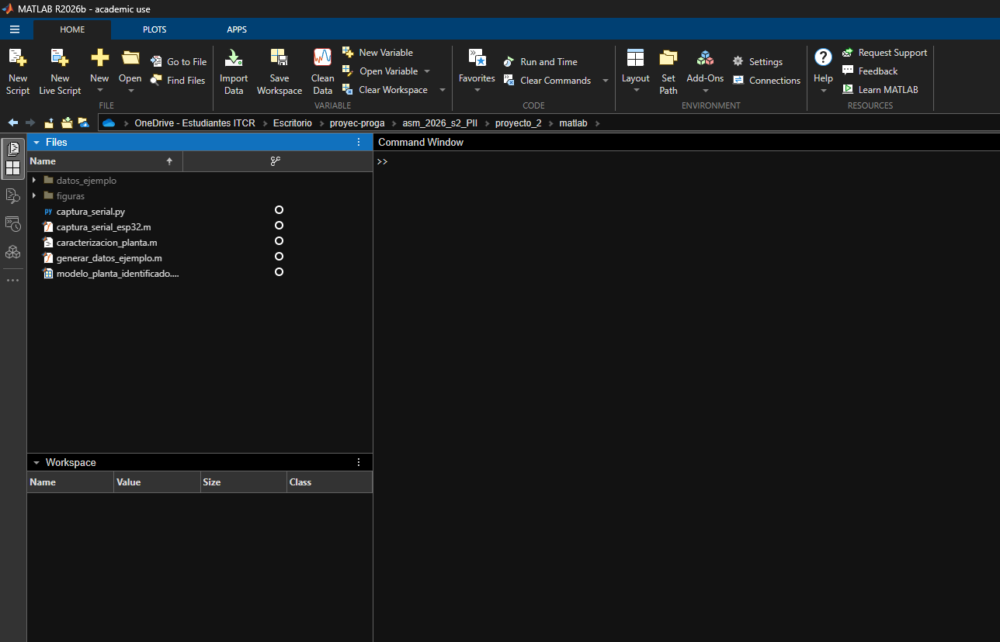
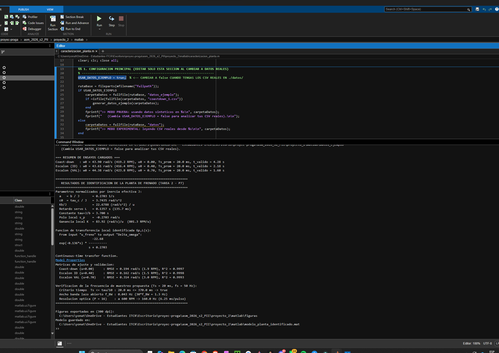

# ffuchs_ymonge_erojas_mgonzalez_asm_2026_s2

Repositorio grupal para **CE 1110 — Análisis de Señales Mixtas** (Instituto Tecnológico de Costa Rica).  
**Sistema:** Banco didáctico de frenado de disco con **ESP32 clásica**, actuador de freno por servomotor **MG996**, sensor óptico **IR AD33838** y caracterización/control digital en **MATLAB** (Tarea 2 y Proyecto Grupal 2).

---

## 1. Estructura del repositorio

```text
proyecto_2/
└── matlab/
    ├── caracterizacion_planta.m      # Script principal: identifica Gp,L(s), grafica escalon e impulse()
    ├── captura_serial_esp32.m        # Captura directa ESP32 -> CSV desde MATLAB (serialport)
    ├── captura_serial.py             # Alternativa ligera en Python (pyserial)
    ├── generar_datos_ejemplo.m       # Genera CSV sinteticos con el formato exacto de la ESP32
    ├── datos/                        # (Se crea al capturar) CSV reales de la maqueta
    ├── datos_ejemplo/                # CSV sinteticos para probar el pipeline sin hardware
    ├── figuras/                      # Graficas exportadas automaticamente en 300 dpi
    ├── docs/capturas/                # Capturas de esta guia
    └── modelo_planta_identificado.mat# Modelo identificado (Gp, Gp_sin_retardo, metricas)
```

---

## 2. Resumen del hardware y pines (ESP32 clásica)

| Subsistema | Componente | Pin ESP32 | Detalle clave |
| :--- | :--- | :--- | :--- |
| **Motor DC + Driver** | JGB37-520 ($12\text{ V}$, $600\text{ RPM}$) + XY-MOS + 1N4006 | `GPIO25` | PWM de potencia ($12\text{ V}/2\text{ A}$ externa) |
| **Freno (actuador)** | Servomotor MG996 ($180^\circ$, engranajes metálicos) | `GPIO26` | Alimentado por portapilas 4xAA ($6\text{ V}$) |
| **Sensor de velocidad** | Sensor óptico reflectivo IR `AD33838` (LM393) | `GPIO27` | Alimentado a `3V3`; disco $\varnothing 130\text{ mm}$ ($R = 0.065\text{ m}$) con **16 bloques negros y 16 blancos** ($P = 16$ pulsos/rev) |
| **Botones (opcionales)** | Inicio / Parada de emergencia | `GPIO32` / `GPIO33` | `INPUT_PULLUP` |
| **Referencia** | Tierra común (`GND`) | `GND` | Unir tierras de ESP32, XY-MOS ($12\text{ V}$), MG996 ($6\text{ V}$) y sensor IR |

---

## 3. Cómo funciona el módulo de MATLAB

El flujo está separado en **captura** y **análisis**, de modo que el equipo puede probar todo con datos sintéticos mientras se termina el firmware `.ino` y el montaje físico:

| Archivo | Propósito |
| :--- | :--- |
| `captura_serial_esp32.m` | Abre el puerto serial de la ESP32 a `115200` baudios, envía el comando `step ...`, escucha entre `#START_CSV` y `#END_CSV`, guarda el `.csv` en `proyecto_2/matlab/datos/` y envía parada segura (`x`) si se interrumpe con `Ctrl+C`. |
| `captura_serial.py` | Misma captura serial usando Python (`pip install pyserial`), por si se prefiere capturar desde terminal. |
| `generar_datos_ejemplo.m` | Simula la dinámica física del disco ($J\dot{\omega} + b\omega + \tau_c + \tau_b(u(t-L)) = 0$) y crea 3 CSV de prueba (`coastdown_1.csv`, `step_u04_1.csv`, `step_u07_1.csv`) con el formato exacto de la ESP32. |
| `caracterizacion_planta.m` | Carga los 3 ensayos (*coast-down*, escalón de identificación y escalón de validación), estima $a = b/J$, $c_0 = \tau_c/J$, $K_b/J$ y el retardo del servo $L$, construye la función de transferencia local $G_{p,L}(s) = \frac{-K_b e^{-Ls}}{Js + b}$, valida contra datos no usados en el ajuste (`step`), genera la **respuesta al impulso en MATLAB (`impulse`)** y verifica polos/Bode frente a $T_s = 20\text{ ms}$. |

---

## 4. Contrato de Entradas y Salidas (para acoplar el firmware `.ino`)

Esta sección define el **acuerdo exacto entre el firmware de la ESP32 y MATLAB** para que ambos módulos encajen a la primera sin cambios manuales.

### 4.1 Entradas que espera MATLAB desde la ESP32 (puerto serial)

* **Velocidad serial:** `115200` baudios, fin de línea `LF` (`\n`, es decir, `Serial.println(...)`).
* **Comandos que puede enviar `captura_serial_esp32.m` a la ESP32:**
  * `step <pwm_ini> <u_freno> <spinup_ms> <pre_ms> <dur_ms>` — ejecuta un ensayo de *coast-down* (`u_freno = 0.0`) o de escalón de frenado (`u_freno > 0.0`).
  * `x` — parada de emergencia inmediata (`motor_pwm = 0`, freno liberado `u_brake = 0`).
* **Marcadores obligatorios de inicio y fin de archivo:**
  * Antes del encabezado CSV, la ESP32 debe imprimir exactamente: `#START_CSV`
  * Al terminar el ensayo, debe imprimir exactamente: `#END_CSV`
  * Cualquier otro texto fuera de esos marcadores se muestra en consola como log (`[ESP32] ...`) y no ensucia el `.csv`.

### 4.2 Formato exacto del archivo CSV (entrada de `caracterizacion_planta.m`)

Encabezado obligatorio en la primera línea después de `#START_CSV`:

```csv
t_ms,phase,motor_pwm,u_brake,servo_deg,rpm_raw,rpm_filt,rad_s,pulses
```

| Columna | Tipo / Unidad | Descripción |
| :--- | :--- | :--- |
| `t_ms` | Entero ($\text{ms}$) | Marca de tiempo cada $T_s = 20\text{ ms}$. Idealmente $< 0$ en fase `PRE` y $\ge 0$ a partir del escalón (`STEP`). |
| `phase` | Texto | Etapa del ensayo (ej. `PRE` antes del corte y `STEP` a partir del corte/frenado). |
| `motor_pwm` | Entero (`0..255`) | Ciclo de trabajo aplicado al módulo XY-MOS (`GPIO25`). Debe caer a `0` exactamente al iniciar el escalón. |
| `u_brake` | Float (`0.0..1.0`) | Acción normalizada de freno (`0.0` en *coast-down* / freno liberado; valor fijo $u_0 \in (0, 1]$ en el escalón). |
| `servo_deg` | Float ($^\circ$) | Ángulo ordenado al servomotor MG996 (`GPIO26`). |
| `rpm_raw` | Float ($\text{RPM}$) | Velocidad angular instantánea sin filtrar medida por el sensor IR (`GPIO27`, $P = 16$). |
| `rpm_filt` | Float ($\text{RPM}$) | Velocidad angular filtrada (EMA suave). |
| `rad_s` | Float ($\text{rad/s}$) | Velocidad angular en $\text{rad/s}$ ($\text{RPM} \cdot 2\pi / 60$). |
| `pulses` | Entero | Conteo acumulado de flancos detectados por interrupción en `GPIO27`. |

Ejemplo de salida esperada por el puerto serial:

```text
#START_CSV
t_ms,phase,motor_pwm,u_brake,servo_deg,rpm_raw,rpm_filt,rad_s,pulses
-40,PRE,190,0.00,20.0,418.5,418.2,43.79,48
-20,PRE,190,0.00,20.0,420.1,418.9,43.87,50
0,STEP,0,0.40,65.0,417.0,418.2,43.79,52
20,STEP,0,0.40,65.0,412.4,416.2,43.58,54
...
#END_CSV
```

> **Nota de robustez para el firmware:** `caracterizacion_planta.m` detecta automáticamente el instante $t = 0$ del escalón siguiendo este orden de prioridad: (1) transición de `motor_pwm > 0` a `motor_pwm == 0`, (2) cruce de `t_ms < 0` a `t_ms >= 0`, o (3) inicio de `u_brake > 0`. Además, si `rad_s` viniera vacío o en cero, lo recalcula automáticamente desde `rpm_filt` o `rpm_raw`.

### 4.3 Salidas que produce MATLAB

1. **Consola (`Command Window`):** tabla de parámetros identificados ($a = b/J$, $c_0 = \tau_c/J$, $K_b/J$, retardo $L$, constante de tiempo $\tau = J/b$, polo $s_p$), expresión de `Gp` (`tf`), métricas de ajuste y validación (`RMSE` y $R^2$) y verificación de $T_s = 20\text{ ms}$.
2. **4 gráficas interactivas + archivos PNG en 300 dpi** (guardados en `proyecto_2/matlab/figuras/` con tema claro automático, listos para el informe en LaTeX/PDF):
   * `fig1_ensayos_lazo_abierto.png` — Velocidad $\omega(t)$ y entrada $u(t)$ en *coast-down* y escalones.
   * `fig2_respuesta_escalon_identificacion.png` — Ajuste experimental vs. `step(u0 * Gp)` y validación cruzada en un segundo escalón.
   * `fig3_respuesta_impulso_matlab.png` — **Respuesta al impulso en MATLAB (`impulse(Gp)`)** con y sin retardo $L$.
   * `fig4_polos_y_muestreo.png` — Mapa de polos/ceros (`pzmap`) y magnitud de Bode comparada con $f_{\text{BW}}$, Nyquist ($25\text{ Hz}$) y $f_s = 50\text{ Hz}$.
3. **Archivo `.mat`:** `proyecto_2/matlab/modelo_planta_identificado.mat` con las variables `Gp`, `Gp_sin_retardo` y la estructura `modelo` (lista para reutilizar al diseñar el PID del Proyecto 2).

---

## 5. Guía paso a paso: cómo ejecutarlo en la app de MATLAB (Windows y macOS)

> **Requisitos:** MATLAB (R2023b o superior, probado en R2026b) con **Control System Toolbox** (incluido en la licencia estudiantil del TEC y en el LAIMI).

### Paso 1 — Abrir la carpeta `proyecto_2/matlab` del repositorio

1. Abre la aplicación de **MATLAB**.
2. En la barra de ruta superior (justo debajo de la pestaña **HOME**), haz clic en el ícono **Browse for Folder** (la carpetita con una flecha verde a la izquierda de la ruta actual).
3. Navega hasta la ubicación donde clonaste este repositorio en tu computadora, selecciona la carpeta **`proyecto_2/matlab`** y confirma:
   * **En Windows:** haz clic en **Select Folder**.
   * **En macOS:** haz clic en **Open** (en Finder).
4. En el panel izquierdo (**Files**) deberías ver los scripts `.m`, `captura_serial.py` y las subcarpetas `datos_ejemplo/` y `figuras/`:



> **Alternativa rápida (Windows y macOS):** también puedes usar **HOME → Open**, navegar a `proyecto_2/matlab` y abrir `caracterizacion_planta.m` directamente. Si al ejecutarlo MATLAB pregunta entre **Change Folder** y **Add to Path**, elige **Change Folder**.

---

### Paso 2 — Abrir `caracterizacion_planta.m` y verificar el modo de ejecución

1. En el panel izquierdo (**Files**), haz **doble clic** en **`caracterizacion_planta.m`** para abrirlo en el **Editor**.
2. Revisa la sección `%% 1. CONFIGURACION PRINCIPAL` (líneas 19–46):
   * **Para probar con los datos simulados** (sin conectar la ESP32): deja `USAR_DATOS_EJEMPLO = true;` en la línea 21.
   * **Para analizar ensayos reales de la maqueta:** cambia la línea 21 a `USAR_DATOS_EJEMPLO = false;` (leerá automáticamente desde `proyecto_2/matlab/datos/`).
   * Si pesaron el disco 3D ($\varnothing 130\text{ mm}$), pueden colocar su masa en kilogramos en `MASA_DISCO_KG` (línea 44) para calcular también $J_{\text{disco}} = \frac{1}{2}mR^2$.


---

### Paso 3 — Ejecutar el script (`Run`) y revisar los resultados en consola

1. Con `caracterizacion_planta.m` abierto, haz clic en el botón verde **Run** en la pestaña **EDITOR** (barra superior):
   * **Atajo en Windows:** `F5`.
   * **Atajo en macOS:** `Fn + F5` (o clic directo en **Run**).
2. En la **Command Window** (panel inferior) aparecerá el resumen de los ensayos cargados, los parámetros identificados, la función de transferencia `Gp,L(s)`, el ajuste ($R^2$, RMSE) y la verificación del periodo de muestreo $T_s = 20\text{ ms}$:



---

### Paso 4 — Revisar las 4 gráficas generadas

Al mismo tiempo que imprime los resultados, MATLAB abre las **4 ventanas de gráficas** (en tema claro, listas para inspección interactiva en el video) y exporta automáticamente los PNG en alta resolución dentro de `proyecto_2/matlab/figuras/`:


---

## 6. Cómo capturar los ensayos reales desde la ESP32 (Windows y macOS)

Cuando la maqueta física y el firmware `.ino` estén listos, conecta la ESP32 por USB y sigue estos 3 pasos desde la **Command Window** de MATLAB (ubicado en `proyecto_2/matlab`):

1. **Identificar el puerto serial de la ESP32:**
   ```matlab
   serialportlist("available")
   ```
   * **En Windows** verás algo como `"COM5"` (o `"COM3"`, `"COM4"`, etc.).
   * **En macOS** verás algo como `"/dev/cu.usbserial-0001"` o `"/dev/cu.SLAB_USBtoUART"` *(usa siempre el que empieza con `/dev/cu.`, no `/dev/tty.`)*.

2. **Capturar el ensayo *coast-down* y al menos dos escalones de frenado** (reemplaza `PUERTO` por el tuyo):
   ```matlab
   % Ejemplo en Windows: PUERTO = "COM5"
   % Ejemplo en macOS:   PUERTO = "/dev/cu.usbserial-0001"
   PUERTO = "COM5";

   captura_serial_esp32(PUERTO, "step 180 0.0 3000 400 6000", "coastdown_1.csv")
   captura_serial_esp32(PUERTO, "step 180 0.4 3000 400 6000", "step_u04_1.csv")
   captura_serial_esp32(PUERTO, "step 180 0.7 3000 400 6000", "step_u07_1.csv")
   ```
   Los archivos se guardarán automáticamente en `proyecto_2/matlab/datos/`.  
   *(Si prefieres capturar desde la terminal con Python: `python captura_serial.py --port COM5 --cmd "step 180 0.4 3000 400 6000" --out step_u04_1.csv`; en macOS usa `python3` y `--port /dev/cu....`).*

3. **Ejecutar la caracterización con los datos reales:**
   * Abre `caracterizacion_planta.m`, cambia la línea 21 a `USAR_DATOS_EJEMPLO = false;` y presiona **Run**.
   * Obtendrás las gráficas reales en `proyecto_2/matlab/figuras/` y el modelo actualizado en `modelo_planta_identificado.mat`.

Repositorio grupal para **CE 1110 — Análisis de Señales Mixtas** (Instituto Tecnológico de Costa Rica).  
**Sistema:** Banco didáctico de frenado de disco con **ESP32 clásica**, actuador de freno por servomotor **MG996**, sensor óptico **IR AD33838** y caracterización/control digital en **MATLAB** (Tarea 2 y Proyecto Grupal 2).

---

## 1. Estructura del repositorio

```text
proyecto_2/
└── matlab/
    ├── caracterizacion_planta.m      # Script principal: identifica Gp,L(s), grafica escalon e impulse()
    ├── captura_serial_esp32.m        # Captura directa ESP32 -> CSV desde MATLAB (serialport)
    ├── captura_serial.py             # Alternativa ligera en Python (pyserial)
    ├── generar_datos_ejemplo.m       # Genera CSV sinteticos con el formato exacto de la ESP32
    ├── datos/                        # (Se crea al capturar) CSV reales de la maqueta
    ├── datos_ejemplo/                # CSV sinteticos para probar el pipeline sin hardware
    ├── figuras/                      # Graficas exportadas automaticamente en 300 dpi
    ├── docs/capturas/                # Capturas de esta guia
    └── modelo_planta_identificado.mat# Modelo identificado (Gp, Gp_sin_retardo, metricas)
```

---

## 2. Resumen del hardware y pines (ESP32 clásica)

| Subsistema | Componente | Pin ESP32 | Detalle clave |
| :--- | :--- | :--- | :--- |
| **Motor DC + Driver** | JGB37-520 ($12\text{ V}$, $600\text{ RPM}$) + XY-MOS + 1N4006 | `GPIO25` | PWM de potencia ($12\text{ V}/2\text{ A}$ externa) |
| **Freno (actuador)** | Servomotor MG996 ($180^\circ$, engranajes metálicos) | `GPIO26` | Alimentado por portapilas 4xAA ($6\text{ V}$) |
| **Sensor de velocidad** | Sensor óptico reflectivo IR `AD33838` (LM393) | `GPIO27` | Alimentado a `3V3`; disco $\varnothing 130\text{ mm}$ ($R = 0.065\text{ m}$) con **16 bloques negros y 16 blancos** ($P = 16$ pulsos/rev) |
| **Botones (opcionales)** | Inicio / Parada de emergencia | `GPIO32` / `GPIO33` | `INPUT_PULLUP` |
| **Referencia** | Tierra común (`GND`) | `GND` | Unir tierras de ESP32, XY-MOS ($12\text{ V}$), MG996 ($6\text{ V}$) y sensor IR |

---

## 3. Cómo funciona el módulo de MATLAB

El flujo está separado en **captura** y **análisis**, de modo que el equipo puede probar todo con datos sintéticos mientras se termina el firmware `.ino` y el montaje físico:

| Archivo | Propósito |
| :--- | :--- |
| `captura_serial_esp32.m` | Abre el puerto serial de la ESP32 a `115200` baudios, envía el comando `step ...`, escucha entre `#START_CSV` y `#END_CSV`, guarda el `.csv` en `proyecto_2/matlab/datos/` y envía parada segura (`x`) si se interrumpe con `Ctrl+C`. |
| `captura_serial.py` | Misma captura serial usando Python (`pip install pyserial`), por si se prefiere capturar desde terminal. |
| `generar_datos_ejemplo.m` | Simula la dinámica física del disco ($J\dot{\omega} + b\omega + \tau_c + \tau_b(u(t-L)) = 0$) y crea 3 CSV de prueba (`coastdown_1.csv`, `step_u04_1.csv`, `step_u07_1.csv`) con el formato exacto de la ESP32. |
| `caracterizacion_planta.m` | Carga los 3 ensayos (*coast-down*, escalón de identificación y escalón de validación), estima $a = b/J$, $c_0 = \tau_c/J$, $K_b/J$ y el retardo del servo $L$, construye la función de transferencia local $G_{p,L}(s) = \frac{-K_b e^{-Ls}}{Js + b}$, valida contra datos no usados en el ajuste (`step`), genera la **respuesta al impulso en MATLAB (`impulse`)** y verifica polos/Bode frente a $T_s = 20\text{ ms}$. |

---

## 4. Contrato de Entradas y Salidas (para acoplar el firmware `.ino`)

Esta sección define el **acuerdo exacto entre el firmware de la ESP32 y MATLAB** para que ambos módulos encajen a la primera sin cambios manuales.

### 4.1 Entradas que espera MATLAB desde la ESP32 (puerto serial)

* **Velocidad serial:** `115200` baudios, fin de línea `LF` (`\n`, es decir, `Serial.println(...)`).
* **Comandos que puede enviar `captura_serial_esp32.m` a la ESP32:**
  * `step <pwm_ini> <u_freno> <spinup_ms> <pre_ms> <dur_ms>` — ejecuta un ensayo de *coast-down* (`u_freno = 0.0`) o de escalón de frenado (`u_freno > 0.0`).
  * `x` — parada de emergencia inmediata (`motor_pwm = 0`, freno liberado `u_brake = 0`).
* **Marcadores obligatorios de inicio y fin de archivo:**
  * Antes del encabezado CSV, la ESP32 debe imprimir exactamente: `#START_CSV`
  * Al terminar el ensayo, debe imprimir exactamente: `#END_CSV`
  * Cualquier otro texto fuera de esos marcadores se muestra en consola como log (`[ESP32] ...`) y no ensucia el `.csv`.

### 4.2 Formato exacto del archivo CSV (entrada de `caracterizacion_planta.m`)

Encabezado obligatorio en la primera línea después de `#START_CSV`:

```csv
t_ms,phase,motor_pwm,u_brake,servo_deg,rpm_raw,rpm_filt,rad_s,pulses
```

| Columna | Tipo / Unidad | Descripción |
| :--- | :--- | :--- |
| `t_ms` | Entero ($\text{ms}$) | Marca de tiempo cada $T_s = 20\text{ ms}$. Idealmente $< 0$ en fase `PRE` y $\ge 0$ a partir del escalón (`STEP`). |
| `phase` | Texto | Etapa del ensayo (ej. `PRE` antes del corte y `STEP` a partir del corte/frenado). |
| `motor_pwm` | Entero (`0..255`) | Ciclo de trabajo aplicado al módulo XY-MOS (`GPIO25`). Debe caer a `0` exactamente al iniciar el escalón. |
| `u_brake` | Float (`0.0..1.0`) | Acción normalizada de freno (`0.0` en *coast-down* / freno liberado; valor fijo $u_0 \in (0, 1]$ en el escalón). |
| `servo_deg` | Float ($^\circ$) | Ángulo ordenado al servomotor MG996 (`GPIO26`). |
| `rpm_raw` | Float ($\text{RPM}$) | Velocidad angular instantánea sin filtrar medida por el sensor IR (`GPIO27`, $P = 16$). |
| `rpm_filt` | Float ($\text{RPM}$) | Velocidad angular filtrada (EMA suave). |
| `rad_s` | Float ($\text{rad/s}$) | Velocidad angular en $\text{rad/s}$ ($\text{RPM} \cdot 2\pi / 60$). |
| `pulses` | Entero | Conteo acumulado de flancos detectados por interrupción en `GPIO27`. |

Ejemplo de salida esperada por el puerto serial:

```text
#START_CSV
t_ms,phase,motor_pwm,u_brake,servo_deg,rpm_raw,rpm_filt,rad_s,pulses
-40,PRE,190,0.00,20.0,418.5,418.2,43.79,48
-20,PRE,190,0.00,20.0,420.1,418.9,43.87,50
0,STEP,0,0.40,65.0,417.0,418.2,43.79,52
20,STEP,0,0.40,65.0,412.4,416.2,43.58,54
...
#END_CSV
```

> **Nota de robustez para el firmware:** `caracterizacion_planta.m` detecta automáticamente el instante $t = 0$ del escalón siguiendo este orden de prioridad: (1) transición de `motor_pwm > 0` a `motor_pwm == 0`, (2) cruce de `t_ms < 0` a `t_ms >= 0`, o (3) inicio de `u_brake > 0`. Además, si `rad_s` viniera vacío o en cero, lo recalcula automáticamente desde `rpm_filt` o `rpm_raw`.

### 4.3 Salidas que produce MATLAB

1. **Consola (`Command Window`):** tabla de parámetros identificados ($a = b/J$, $c_0 = \tau_c/J$, $K_b/J$, retardo $L$, constante de tiempo $\tau = J/b$, polo $s_p$), expresión de `Gp` (`tf`), métricas de ajuste y validación (`RMSE` y $R^2$) y verificación de $T_s = 20\text{ ms}$.
2. **4 gráficas interactivas + archivos PNG en 300 dpi** (guardados en `proyecto_2/matlab/figuras/` con tema claro automático, listos para el informe en LaTeX/PDF):
   * `fig1_ensayos_lazo_abierto.png` — Velocidad $\omega(t)$ y entrada $u(t)$ en *coast-down* y escalones.
   * `fig2_respuesta_escalon_identificacion.png` — Ajuste experimental vs. `step(u0 * Gp)` y validación cruzada en un segundo escalón.
   * `fig3_respuesta_impulso_matlab.png` — **Respuesta al impulso en MATLAB (`impulse(Gp)`)** con y sin retardo $L$.
   * `fig4_polos_y_muestreo.png` — Mapa de polos/ceros (`pzmap`) y magnitud de Bode comparada con $f_{\text{BW}}$, Nyquist ($25\text{ Hz}$) y $f_s = 50\text{ Hz}$.
3. **Archivo `.mat`:** `proyecto_2/matlab/modelo_planta_identificado.mat` con las variables `Gp`, `Gp_sin_retardo` y la estructura `modelo` (lista para reutilizar al diseñar el PID del Proyecto 2).

---

## 5. Guía paso a paso: cómo ejecutarlo en la app de MATLAB (Windows y macOS)

> **Requisitos:** MATLAB (R2023b o superior, probado en R2026b) con **Control System Toolbox** (incluido en la licencia estudiantil del TEC y en el LAIMI).

### Paso 1 — Abrir la carpeta `proyecto_2/matlab` del repositorio

1. Abre la aplicación de **MATLAB**.
2. En la barra de ruta superior (justo debajo de la pestaña **HOME**), haz clic en el ícono **Browse for Folder** (la carpetita con una flecha verde a la izquierda de la ruta actual).
3. Navega hasta la ubicación donde clonaste este repositorio en tu computadora, selecciona la carpeta **`proyecto_2/matlab`** y confirma:
   * **En Windows:** haz clic en **Select Folder**.
   * **En macOS:** haz clic en **Open** (en Finder).
4. En el panel izquierdo (**Files**) deberías ver los scripts `.m`, `captura_serial.py` y las subcarpetas `datos_ejemplo/` y `figuras/`:


> **Alternativa rápida (Windows y macOS):** también puedes usar **HOME → Open**, navegar a `proyecto_2/matlab` y abrir `caracterizacion_planta.m` directamente. Si al ejecutarlo MATLAB pregunta entre **Change Folder** y **Add to Path**, elige **Change Folder**.

---

### Paso 2 — Abrir `caracterizacion_planta.m` y verificar el modo de ejecución

1. En el panel izquierdo (**Files**), haz **doble clic** en **`caracterizacion_planta.m`** para abrirlo en el **Editor**.
2. Revisa la sección `%% 1. CONFIGURACION PRINCIPAL` (líneas 19–46):
   * **Para probar con los datos simulados** (sin conectar la ESP32): deja `USAR_DATOS_EJEMPLO = true;` en la línea 21.
   * **Para analizar ensayos reales de la maqueta:** cambia la línea 21 a `USAR_DATOS_EJEMPLO = false;` (leerá automáticamente desde `proyecto_2/matlab/datos/`).
   * Si pesaron el disco 3D ($\varnothing 130\text{ mm}$), pueden colocar su masa en kilogramos en `MASA_DISCO_KG` (línea 44) para calcular también $J_{\text{disco}} = \frac{1}{2}mR^2$.


---

### Paso 3 — Ejecutar el script (`Run`) y revisar los resultados en consola

1. Con `caracterizacion_planta.m` abierto, haz clic en el botón verde **Run** en la pestaña **EDITOR** (barra superior):
   * **Atajo en Windows:** `F5`.
   * **Atajo en macOS:** `Fn + F5` (o clic directo en **Run**).
2. En la **Command Window** (panel inferior) aparecerá el resumen de los ensayos cargados, los parámetros identificados, la función de transferencia `Gp,L(s)`, el ajuste ($R^2$, RMSE) y la verificación del periodo de muestreo $T_s = 20\text{ ms}$:


---

### Paso 4 — Revisar las 4 gráficas generadas

Al mismo tiempo que imprime los resultados, MATLAB abre las **4 ventanas de gráficas** (en tema claro, listas para inspección interactiva en el video) y exporta automáticamente los PNG en alta resolución dentro de `proyecto_2/matlab/figuras/`:


---

## 6. Cómo capturar los ensayos reales desde la ESP32 (Windows y macOS)

Cuando la maqueta física y el firmware `.ino` estén listos, conecta la ESP32 por USB y sigue estos 3 pasos desde la **Command Window** de MATLAB (ubicado en `proyecto_2/matlab`):

1. **Identificar el puerto serial de la ESP32:**
   ```matlab
   serialportlist("available")
   ```
   * **En Windows** verás algo como `"COM5"` (o `"COM3"`, `"COM4"`, etc.).
   * **En macOS** verás algo como `"/dev/cu.usbserial-0001"` o `"/dev/cu.SLAB_USBtoUART"` *(usa siempre el que empieza con `/dev/cu.`, no `/dev/tty.`)*.

2. **Capturar el ensayo *coast-down* y al menos dos escalones de frenado** (reemplaza `PUERTO` por el tuyo):
   ```matlab
   % Ejemplo en Windows: PUERTO = "COM5"
   % Ejemplo en macOS:   PUERTO = "/dev/cu.usbserial-0001"
   PUERTO = "COM5";

   captura_serial_esp32(PUERTO, "step 180 0.0 3000 400 6000", "coastdown_1.csv")
   captura_serial_esp32(PUERTO, "step 180 0.4 3000 400 6000", "step_u04_1.csv")
   captura_serial_esp32(PUERTO, "step 180 0.7 3000 400 6000", "step_u07_1.csv")
   ```
   Los archivos se guardarán automáticamente en `proyecto_2/matlab/datos/`.  
   *(Si prefieres capturar desde la terminal con Python: `python captura_serial.py --port COM5 --cmd "step 180 0.4 3000 400 6000" --out step_u04_1.csv`; en macOS usa `python3` y `--port /dev/cu....`).*

3. **Ejecutar la caracterización con los datos reales:**
   * Abre `caracterizacion_planta.m`, cambia la línea 21 a `USAR_DATOS_EJEMPLO = false;` y presiona **Run**.
   * Obtendrás las gráficas reales en `proyecto_2/matlab/figuras/` y el modelo actualizado en `modelo_planta_identificado.mat`.
