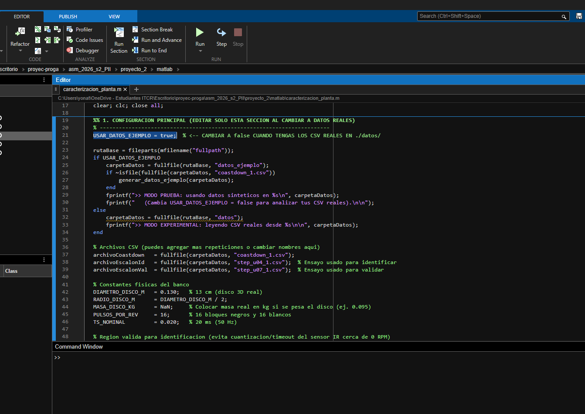
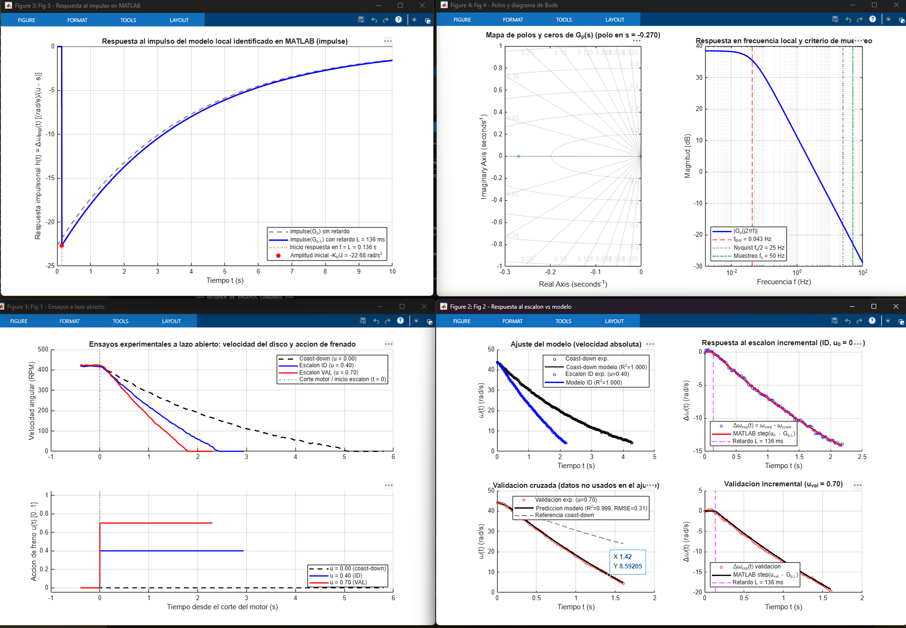

# ffuchs_ymonge_erojas_mgonzalez_asm_2026_s2

Repositorio grupal para **CE 1110 — Análisis de Señales Mixtas** (Instituto Tecnológico de Costa Rica).  
**Sistema:** Banco didáctico de frenado de disco con **ESP32 clásica**, actuador de freno por servomotor **MG996**, sensor óptico **IR AD33838** y suite de modelado, diseño PID y evaluación en **MATLAB** (Tarea 2 y Proyecto Grupal 2).

---

## 1. Estructura del repositorio

```text
proyecto_2/
├── PLAN_DE_TRABAJO_PROYECTO_2.md             # Plan maestro incremental (requisitos mínimos y extras)
├── firmware/
│   └── freno_pid_esp32/
│       └── freno_pid_esp32.ino               # Firmware ESP32: estimador por ventana, step, PID y hooks E3/E4
└── matlab/
    ├── +frenado/                             # Paquete compartido (lectura, validación, identificación, rampas)
    │   ├── leerCSV.m                         # Lector dual para formato step (9 cols) y runpid (15 cols)
    │   ├── validarTabla.m                    # Validación estricta de esquema, rangos, fases y flags
    │   ├── cargarEnsayoCSV.m                 # Normaliza corte real (t=0); auto usa w_meas en runpid
    │   ├── validarComandoTabla.m             # Verifica coherencia entre comando enviado y CSV
    │   ├── tiemposCaptura.m                  # Validación de sintaxis y timeouts para step / runpid
    │   ├── capturarFlujo.m                   # Máquina de estados serial verificable (#START_CSV..#RESULT)
    │   ├── identificar.m                     # Ajuste FOPDT acotado (coast-down + escalón con retardo L)
    │   ├── evaluarCoastdown.m                # Solución analítica de pérdidas naturales
    │   ├── evaluarDeltaW.m                   # Respuesta incremental local al escalón con retardo L
    │   ├── respuestaEscalon.m                # Evaluación de step(u*Gp) preservando jitter temporal real
    │   └── referenciaRampa.m                 # Fórmula única w_ref(t) = max(w_stop, w0 - r_ref*max(0,t))
    ├── caracterizacion_planta.m              # M1 (Etapa 3): identifica Gp,L(s), valida e impulse(Gp)
    ├── diseno_pid.m                          # M2 (Etapa 4): c2d(ZOH), plano Z, rampas y simulación PID
    ├── identificacion_semiautomatica.m       # E1 (+2 pts): captura 3 ensayos + ajusta + sugiere PID
    ├── evaluacion_experimentos.m             # Evaluación de ajuste P/PI/PID y finales V1/V2 (figuras + .tex)
    ├── evaluacion_extras.m                   # Evaluación de extras E2 (polos/margen Z), E3, E4 y E5
    ├── captura_serial_esp32.m                # Captura directa ESP32 -> CSV desde MATLAB (serialport)
    ├── captura_serial.py                     # Alternativa ligera en Python (pyserial) con --setup y -f
    ├── graficar_ensayos.py                   # Graficador universal desde terminal (invoca MATLAB -batch)
    ├── generar_datos_ejemplo.m               # Genera CSV sintéticos (step 9 cols + runpid 15 cols)
    ├── modelo_planta_identificado.mat        # Modelo canónico (Gp, a, c0, Kb_J, L)
    ├── diseno_pid_resultado.mat              # Ganancias, Cz, Tz_d y rampas de diseno_pid.m
    ├── condiciones_diseno.json               # Pares (r_ref, w_stop) y comandos pid/ref en JSON
    ├── datos/                                # CSV reales organizados por etapa
    │   ├── identificacion/                   # Trío oficial M1 (coast-down + 2 escalones)
    │   ├── ajuste/                           # Corridas oficiales P, PI, PID (Etapa 5)
    │   ├── finales/                          # Corridas finales V1/V2 x OPEN/PID x 3 (Etapa 6)
    │   ├── extras/                           # Corridas extras E2, E3, E4, E5
    │   ├── pruebas_pid/                      # Pruebas exploratorias de sintonización
    │   └── historico/                        # Capturas previas de depuración
    ├── datos_ejemplo/                        # CSV sintéticos (ajuste/, finales/ + condiciones_ejemplo.json, extras/)
    ├── figuras/                              # Figuras base de referencia
    ├── docs/                                 # Capturas de guía y CONTEXTO_EVALUACION_MARIANA.md
    └── tests/
        ├── test_frenado.m                    # Suite unitaria y de integración en MATLAB (28 tests)
        ├── test_capture.py                   # Suite de protocolo serial en Python (31 tests + fuzz)
        └── validation_summary.json           # Resumen verificado y hashes SHA-256
```

---

## 2. Resumen del hardware y pines (ESP32 clásica)

| Subsistema | Componente | Pin ESP32 | Detalle clave |
| :--- | :--- | :--- | :--- |
| **Motor DC + Driver** | JGB37-520 ($12\text{ V}$, $600\text{ RPM}$) + XY-MOS + 1N4006 | `GPIO25` | PWM de potencia ($20\text{ kHz}$, 8 bits, fuente $12\text{ V}/2\text{ A}$) |
| **Freno (actuador)** | Servomotor MG996 ($180^\circ$, engranajes metálicos) | `GPIO26` | PWM $50\text{ Hz}$, 14 bits; alimentado por portapilas 4xAA ($6\text{ V}$) |
| **Sensor de velocidad** | Sensor óptico reflectivo IR `AD33838` (LM393) | `GPIO27` | Alimentado a `3V3`; disco $\varnothing 130\text{ mm}$ ($R = 0.065\text{ m}$). El parámetro `PulsosPorRev` (`P`) vive en una sola constante arriba del `.ino` y de `caracterizacion_planta.m` |
| **Botón de inicio** | Pulsador de arranque manual | `GPIO32` | `INPUT_PULLDOWN` (activo en `HIGH`) |
| **Botón de parada** | Pulsador de parada de emergencia | `GPIO33` | `INPUT_PULLDOWN` (activo en `HIGH`; corta `PWM=0` y libera freno) |
| **Referencia** | Tierra común (`GND`) | `GND` | Unir tierras de ESP32, XY-MOS ($12\text{ V}$), MG996 ($6\text{ V}$) y sensor IR |

---

## 3. Cómo funciona el módulo de MATLAB

El lazo de control PID en tiempo real corre **100 % en la ESP32**. MATLAB actúa fuera de tiempo real para **captura verificada, modelado de la planta, diseño del PID y análisis experimental**:

| Archivo | Propósito |
| :--- | :--- |
| `captura_serial_esp32.m` | Abre el puerto serial a `115200` baudios, valida sintaxis y timeouts de `step` o `runpid`, escucha entre `#START_CSV` y `#END_CSV` + `#RESULT`, publica `.csv` y `.capture.json` en `datos/` y envía `x` al salir o ante `Ctrl+C`. |
| `captura_serial.py` | Misma máquina de estados y validación en Python (`pip install pyserial`). |
| `generar_datos_ejemplo.m` | Simula la dinámica no lineal del banco y genera CSV sintéticos tanto en formato `step` (`coastdown_1.csv`, `step_u04_1.csv`, `step_u07_1.csv`) como en formato `runpid` (`ajuste/`, `finales/` con `condiciones_ejemplo.json` y `extras/`). |
| `caracterizacion_planta.m` | **(M1)** Carga *coast-down* + escalón ID + escalón de validación distinto, estima $a = b/J$, $c_0 = \tau_c/J$, $K_b/J$ y retardo $L$, construye $G_{p,L}(s) = \frac{-K_b e^{-Ls}}{Js + b}$, calcula `impulse(Gp)`, valida $R^2$ sobre ensayo nuevo y actualiza `modelo_planta_identificado.mat`. |
| `diseno_pid.m` | **(M2)** Discretiza `Gp` con `c2d(..., 'zoh')`, compara retardo $z^{-d}$ vs. Padé, calcula ganancias $(K_p, K_i, K_d, T_f)$ en $\text{rad/s}$ garantizando polos de $T(z)$ dentro de $|z| < 1$, define rampas realizables (`V1`, `V2`), simula saturación `[0,1]` + *anti-windup*, imprime comandos `pid`/`ref` para la ESP32 y exporta `diseno_pid_resultado.mat` + `condiciones_diseno.json`. |
| `identificacion_semiautomatica.m` | **(E1)** Orquestador de un solo comando: dispara *coast-down* + 2 escalones en la ESP32, ajusta y valida el modelo (`caracterizacion_planta`) y calcula automáticamente las ganancias PID y rampas sugeridas (`diseno_pid`). |

---

## 4. Contratos de Entradas y Salidas (ESP32 ↔ MATLAB)

### 4.1 Protocolo serial (`115200` baudios, fin de línea `LF` `\n`)

* **Comandos soportados:**
  * `step <pwm_ini> <u_freno> <spinup_ms> <pre_ms> <dur_ms>` — ensayo a lazo abierto (*coast-down* con `u_freno = 0` o escalón fijo `u_freno > 0`).
  * `runpid <pwm_ini> <spinup_ms> <pre_ms> <dur_ms>` — ensayo con el controlador PID digital en ESP32.
  * `pid <kp> <ki> <kd> <tf>` y `ref <rate_rad_s2> <w_stop_rad_s>` — configuración en vivo de ganancias (en $\text{rad/s}$) y rampa de referencia.
  * `x` — parada de emergencia inmediata (`motor_pwm = 0`, freno liberado).
* **Marcadores obligatorios de captura:** `#START_CSV` antes del encabezado, `#END_CSV` al finalizar las muestras y `#RESULT parada_detectada`, `#RESULT duracion_maxima` o `#RESULT w_final_alcanzada` (solo `runpid`) al cierre.

### 4.2 Formato CSV `step` (9 columnas — lazo abierto)

```csv
t_ms,phase,motor_pwm,u_brake,servo_deg,rpm_raw,rpm_filt,rad_s,pulses
```

* `phase`: `PRE` (`t_ms < 0`, `motor_pwm > 0`, `u_brake = 0`) y `BRAKE` (o `STEP`, `t_ms >= 0`, `motor_pwm = 0`, `u_brake` constante).
* En `frenado.cargarEnsayoCSV(ruta)` (1 argumento), los ensayos `step` usan `rpm_raw` por defecto (`filtrada = false`) para no enmascarar el retardo $L$ al identificar la planta.

### 4.3 Formato CSV `runpid` (15 columnas — PID y comparativas finales)

```csv
t_ms,phase,ctrl_mode,motor_pwm,w_ref,w_meas,w_raw,error,u_brake,p_term,i_term,d_term,servo_deg,pulses,flags
```

* Distinguido automáticamente por la presencia de la columna `ctrl_mode` (`OPEN` o `PID`).
* Todas las velocidades (`w_ref`, `w_meas`, `w_raw`) y el error (`error = w_meas - w_ref`) están en **rad/s**.
* `flags` (máscara de bits entera sin signo):
  * **Bit 0 (`1`):** `u = 0` saturado
  * **Bit 1 (`2`):** `u = 1` saturado
  * **Bit 2 (`4`):** antibloqueo simplificado activo (**E3**)
  * **Bit 3 (`8`):** región baja de *gain scheduling* activo (**E4**)
  * **Bit 4 (`16`):** *anti-windup* actuando
* En `frenado.cargarEnsayoCSV(ruta)` (1 argumento), los ensayos `runpid` usan `w_meas` por defecto (`filtrada = true`) para mantener coherencia exacta con `error = w_meas - w_ref`.

### 4.4 Acuerdo de referencia en lazo abierto y contratos de salida

* **Referencia justa en lazo abierto (`step` 9 cols):** cuando una corrida de lazo abierto no incluye `w_ref`, se reconstruye la rampa de su condición (`V1` o `V2`) usando la función compartida `frenado.referenciaRampa(t, w0, r_ref, w_stop)` con los parámetros de `condiciones_diseno.json` (o `datos_ejemplo/finales/condiciones_ejemplo.json`).
* **Contrato `.mat` de planta:** `modelo_planta_identificado.mat` expone las variables `Gp`, `a`, `c0`, `Kb_J`, `L` (además de `Gp_sin_retardo` y `modelo`).
* **Contrato `.mat`/JSON de diseño:** `diseno_pid_resultado.mat` y `condiciones_diseno.json` exponen `Kp`, `Ki`, `Kd`, `Tf`, `Ts`, `Cz`, `Tz_d`, `refV1`, `refV2`, `cmd_pid`, `cmd_ref_v1` y `cmd_ref_v2`.

---

## 5. Guía paso a paso: cómo ejecutarlo en la app de MATLAB (Windows y macOS)

> **Requisitos:** MATLAB (R2023b o superior, probado en R2026b) con **Control System Toolbox** (incluido en la licencia estudiantil del TEC y en el LAIMI).

### Paso 1 — Abrir la carpeta `proyecto_2/matlab` del repositorio

1. Abre la aplicación de **MATLAB**.
2. En la barra de ruta superior (debajo de **HOME**), haz clic en **Browse for Folder** (la carpetita con una flecha verde).
3. Selecciona la carpeta **`proyecto_2/matlab`** dentro de tu copia local del repositorio:
   * **En Windows:** haz clic en **Select Folder**.
   * **En macOS:** haz clic en **Open** (en Finder).
4. En el panel izquierdo (**Files**) aparecerán los scripts, `+frenado/`, `datos_ejemplo/`, `figuras/` y `tests/`:


> **Alternativa rápida (Windows y macOS):** usa **HOME → Open** sobre `caracterizacion_planta.m`; si al correr MATLAB pregunta entre **Change Folder** y **Add to Path**, elige **Change Folder**.

---

### Paso 2 — Revisar parámetros de `caracterizacion_planta.m`

1. Haz **doble clic** en **`caracterizacion_planta.m`** para abrirlo en el **Editor**.
2. En el bloque `arguments` (líneas 17–39):
   * `PulsosPorRev` (`32` por defecto, confirmado en maqueta) y `MasaDiscoKg` (`NaN` si aún no se pesa; opcional) están centralizados en un solo lugar.
   * `UsarDatosEjemplo` (`true` por defecto): usa datos sintéticos de prueba; cámbialo a `false` cuando analices tus CSV reales de `datos/`.
   * Al correr sin `CarpetaResultados` personalizado, actualiza automáticamente `modelo_planta_identificado.mat` en la raíz de `proyecto_2/matlab/`.



---

### Paso 3 — Ejecutar el script (`Run`) y revisar los resultados en consola

1. Con `caracterizacion_planta.m` abierto, presiona el botón verde **Run** (en **Windows:** `F5`; en **macOS:** `Fn + F5`).
2. En la **Command Window** se imprime el resumen de ensayos, los parámetros (`a`, `c0`, `Kb_J`, `L`), la función `Gp,L(s)`, la validación cruzada (`R^2`, `RMSE`), polos/ceros y la verificación de $T_s = 20\text{ ms}$:


---

### Paso 4 — Revisar las 4 gráficas generadas

MATLAB abre las **4 ventanas de gráficas** (con tema claro automático aunque la app esté en modo oscuro) y guarda las imágenes en 300 dpi dentro de `resultados/<modo>/<timestamp>/figuras/`:



---

### Paso 5 — Diseñar el PID inicial en MATLAB (`diseno_pid.m`)

Una vez actualizado `modelo_planta_identificado.mat`, abre `diseno_pid.m` y presiona **Run** (o ejecuta en la Command Window):

```matlab
diseno_pid()
```

Esto genera las 3 gráficas de diseño (polos/ceros en $Z$, región realizable de rampas y simulación no lineal con saturación + *anti-windup*), guarda `diseno_pid_resultado.mat` + `condiciones_diseno.json` e imprime las líneas exactas para copiar al Monitor Serial de la ESP32:

```text
pid <Kp> <Ki> <Kd> <Tf>
ref <r_ref_v1> <w_stop>
ref <r_ref_v2> <w_stop>
```

---

## 6. Manual rápido de pruebas físicas y recopilación de datos (copiar y pegar)

### 6.0 Preparación y seguridad (antes de conectar)

1. Carga `proyecto_2/firmware/freno_pid_esp32/freno_pid_esp32.ino` a la ESP32 desde Arduino IDE (`115200` baudios).
2. Verifica que el disco gire libre, sin cables ni manos cerca, con el servo firme y el botón de parada (`GPIO33`) a mano (también podés enviar `x` por serial en cualquier momento).
3. **Qué debe pasar al encender/resetear la ESP32:** motor quieto (`PWM = 0`) y servo en **`35°`** (zapata separada del disco).

### 6.1 Chequeo rápido en Monitor Serial (115200 baudios)

Antes de capturar CSVs, verifica el ajuste mecánico (con el disco bien fijado al eje y **`P = 32` pulsos/vuelta** ya confirmado):

```text
info
s 35
s 49
s 52
x
```
* **Qué debe pasar:** en `35°` no roza el disco; en `49°` apenas hace primer contacto; en `52°` frena firme sin que el servo zumbe ni se trabe. *(Si incluso en `u = 0.85` el frenado sigue muy parecido al coast-down, acercar un poco más la zapata o recalibrar `SERVO_CONTACT_DEG`/`SERVO_MAX_SAFE_DEG` con `s <deg>`).*
* **Importante:** **cierra el Monitor Serial de Arduino IDE** antes de correr Python o MATLAB, si no el puerto `COM` queda bloqueado.

### 6.2 Ubicar el puerto serial

Desde PowerShell/terminal en `proyecto_2/matlab` (instalar una vez `pip install pyserial` si falta):

```bash
python captura_serial.py --list
```

*(En MATLAB: `serialportlist("available")`. En Windows verás algo como `COM5`; en macOS usa `/dev/cu.usbserial-...`).*

### 6.3 Recopilar los 3 ensayos `step` para identificar la planta (M1)

Con el disco bien fijado al eje, sustituye `COM5` por tu puerto y ejecuta los 3 comandos uno por uno desde `proyecto_2/matlab` (usando **`PWM = 255`** para mayor velocidad inicial y **`u = 0.50` / `0.85`** para separar bien la acción del freno frente al coast-down):

1. **Coast-down (`u = 0`, freno suelto):**
   ```bash
   python captura_serial.py --port COM5 --cmd "step 255 0 3000 1000 10000" --out real_coastdown_255.csv
   ```
   *Qué debe pasar:* `0.5 s` en reposo (`35°`) → motor acelera `3 s` a máxima velocidad → gira estable `1 s` → corta motor y el disco se detiene **solo por fricción** (servo sigue en `35°`) → guarda `.csv` y `.capture.json` en `proyecto_2/matlab/datos/`.

2. **Escalón medio (`u = 0.50`, `~50.5°`):**
   ```bash
   python captura_serial.py --port COM5 --cmd "step 255 0.50 3000 1000 6000" --out real_step_u050_255.csv
   ```
   *Qué debe pasar:* acelera igual → corta motor → la zapata frena el disco **claramente más rápido** que el coast-down → al detenerse, **suelta la zapata de vuelta a `35°`**.

3. **Escalón fuerte (`u = 0.85`, `~51.55°`, validación independiente):**
   ```bash
   python captura_serial.py --port COM5 --cmd "step 255 0.85 3000 1000 6000" --out real_step_u085_255.csv
   ```
   *Qué debe pasar:* frena todavía más rápido que `u = 0.50` sin trabar/forzar el servo (ideal que tarde al menos `0.4–0.5 s` en frenar). Si `0.85` clava demasiado brusco, probar `u = 0.40` y `u = 0.70`.

**Alternativa en 1 comando desde MATLAB (Extra E1):**

```matlab
resumen = identificacion_semiautomatica("COM5");
```

Dispara secuencialmente *coast-down* + dos escalones (`PWM=255`, `u=0.50`, `u=0.85`, `PulsosPorRev=32`), valida $R^2$ sobre el segundo escalón y calcula automáticamente las ganancias PID y rampas sugeridas. Para probarlo sin hardware:

```matlab
resumen = identificacion_semiautomatica("", ModoEjemplo=true);
```

### 6.4 Prueba en lazo cerrado (`runpid`)

> **Nota:** al abrir el puerto serial la ESP32 se reinicia y las ganancias vuelven a `0`, por eso **siempre** envía `--setup "pid ..."` y `--setup "ref ..."` (o `Setup=[...]` en MATLAB) antes de `runpid`.

* **Desde terminal (Python):**
  ```bash
  python captura_serial.py --port COM5 --setup "pid 0.006 0.02 0 0.05" --setup "ref 55 5" --cmd "runpid 255 3000 1000 8000" --out real_pid_255.csv
  ```
* **Desde MATLAB (`captura_serial_esp32.m`):**
  ```matlab
  PUERTO = "COM5"; % En macOS: "/dev/cu.usbserial-0001"

  captura_serial_esp32(PUERTO, "step 255 0 3000 1000 10000", "real_coastdown_255.csv")
  captura_serial_esp32(PUERTO, "step 255 0.50 3000 1000 6000", "real_step_u050_255.csv")
  captura_serial_esp32(PUERTO, "step 255 0.85 3000 1000 6000", "real_step_u085_255.csv")
  captura_serial_esp32(PUERTO, "runpid 255 3000 1000 8000", "real_pid_255.csv", ...
      Setup=["pid 0.006 0.02 0 0.05", "ref 55 5"])
  ```
* **Qué debe pasar físicamente:** acelera `3 s` → `1 s` estable → corta motor → el servo **modula progresivamente** entre `49°` y `52°` siguiendo la rampa → al bajar a `5 rad/s` suelta la zapata a `35°` y cierra con `w_final_alcanzada`.

### 6.5 Analizar los datos reales en MATLAB

Con los 3 CSV reales en `proyecto_2/matlab/datos/`, ejecuta en MATLAB (usa `RetardoCorteSeg=0.18` si persiste una meseta inicial de corte en el coast-down):

```matlab
caracterizacion_planta(UsarDatosEjemplo=false, PulsosPorRev=32, ...
    ArchivoCoastdown="real_coastdown_255.csv", ...
    ArchivoIdentificacion="real_step_u050_255.csv", ...
    ArchivoValidacion="real_step_u085_255.csv")
diseno_pid()
```

### 6.6 Suite de pruebas automatizadas (sin hardware)

* **En MATLAB** (desde `proyecto_2/matlab`):
  ```matlab
  results = runtests("tests/test_frenado.m"); assertSuccess(results)
  ```
* **En Python** (desde `proyecto_2/matlab`):
  ```bash
  python -B -m unittest discover -s tests -p "test_*.py" -v
  ```
