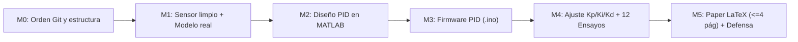

# Plan de Trabajo Incremental — Proyecto Grupal 2 (CE 1110)

**Curso:** CE 1110 — Análisis de Señales Mixtas (Instituto Tecnológico de Costa Rica)  
**Profesor:** Luis Chavarría Zamora  
**Proyecto:** Diseño de un sistema de control de frenado tipo ABS (banco didáctico con PID digital)  
**Fecha de entrega y defensa en vivo:** **2 de diciembre de 2026** (defensa de 15 min + entrega de todos los archivos y código fuente a las **11:50 pm**)  
**Repositorio:** `ffuchs_ymonge_erojas_mgonzalez_asm_2026_s2`  
**Evaluación:**
* **65 %** — Presentación de proyecto 100 % funcional (defensa de 15 minutos en vivo).
* **35 %** — Documentación: artículo científico tipo *paper* en **LaTeX** (IEEE Transactions o ACM), **máximo 4 páginas completas incluyendo referencias** (30 % paper + formato/lineamientos).
* **+15 % extra máximo** sobre la parte funcional — **solo se habilita si funciona el 100 % de los requisitos mínimos obligatorios**, con demostración funcional, datos y análisis.
* **Condición eliminatoria de Git:** si no se sigue el flujo de ramas (`main`/`master` + `develop` + ramas por funcionalidad + `tag` final) o se sube todo en un solo commit, la parte funcional obtiene **nota de cero**.

---

## 0. Aclaración de Arquitectura para Todo el Equipo (ESP32 vs. MATLAB)

Para evitar confusiones durante el desarrollo, la frontera entre firmware y MATLAB es fija:

* **Firmware ESP32 (`.ino` en Arduino IDE) — TIEMPO REAL (100 % autónomo):**
  * La ESP32 sola acelera el motor DC, lee los pulsos del sensor IR por interrupciones, calcula la velocidad angular, ejecuta el **controlador PID discreto** cada $T_s = 20\text{ ms}$ (sin `delay()`), mueve el servomotor de freno y aplica protecciones/parada de emergencia.
  * El sistema físico **no depende de MATLAB ni de la computadora para frenar**.
* **MATLAB (scripts `.m`) — FUERA DE TIEMPO REAL (diseño, grabación CSV y análisis):**
  * **Antes del PID:** lee los CSV de lazo abierto, identifica el modelo matemático $G_{p,L}(s)$, analiza polos/ceros en $s$ y $z$, y calcula ganancias iniciales $(K_p, K_i, K_d, T_f)$ para copiarlas al `.ino`.
  * **Durante las pruebas:** actúa únicamente como grabadora de datos por puerto serial hacia archivos `.csv` (sin intervenir en el lazo de control).
  * **Después de las pruebas:** compara los CSV de lazo abierto vs. PID (IAE, RMSE, tiempo de frenado, oscilaciones, saturación, variabilidad) y genera las figuras en 300 dpi para el paper en LaTeX.

---

## 1. Hardware Oficial, Componentes y Mapeo de Pines (ESP32 Clásica)

> [!IMPORTANT]
> **Regla estricta:** todo firmware del Proyecto 2 debe seguir entregándose en **un archivo `.ino` compatible con Arduino IDE** y respetar **exactamente estos pines y componentes** sin reasignar GPIOs.

### 1.1 Componentes instalados en la maqueta

| Subsistema | Componente | Código / Modelo | Especificación y rol en el banco |
| :--- | :--- | :--- | :--- |
| **Microcontrolador** | ESP32 clásica (DevKit) | Lógica $3.3\text{ V}$ | Alimentada por USB; ejecuta lectura IR, FSM y PID digital a $50\text{ Hz}$. |
| **Motor DC** | JGB37-520 12VDC 600RPM Gear Motor | `AD52072` | $12\text{ V}$, $600\text{ RPM}$, eje tipo "D" de $6\text{ mm}$; acelera el disco hasta $\omega_0$ antes de cada ensayo. |
| **Driver de motor** | XY-MOS High Power MOSFET Trigger Switch PWM | `AD81187` | Etapa de potencia PWM compatible con lógica de $3.3\text{ V}$; corta el motor al iniciar el frenado. |
| **Protección motor** | Diodo rectificador 1N4006 ($800\text{ V}$, $1\text{ A}$) | `AD12185` | Diodo *flyback* en antiparalelo a los terminales del motor DC. |
| **Actuador de freno** | Servomotor MG996 [$180^\circ$] Standard – Metal Gear | `AD18394` | Acciona la zapata de goma contra el borde del disco (actuador unilateral: solo frena). |
| **Sensor de velocidad** | IR Obstacle Sensor Breakout Board (LM393) | `AD33838` | Sensor óptico reflectivo digital alimentado a $3.3\text{ V}$ desde la ESP32. |
| **Disco rotatorio** | Disco impreso en 3D ($\varnothing 130\text{ mm}$, $R = 0.065\text{ m}$) | Personalizado | Montado en el eje del motor; pista lateral con **16 bloques negros y 16 espacios blancos iguales**. |
| **Fuente motor** | Adaptador AC-DC $12\text{ V}$ / $2\text{ A}$ | Externa | Alimentación exclusiva de potencia del módulo XY-MOS. |
| **Fuente servo** | Portapilas 4xAA (`NB-4AA`) | `AD13184` | $6\text{ V}$ nominales dedicados al servomotor MG996. |
| **Botones físicos** | 2 pulsadores (inicio y parada de emergencia) | Push-buttons | Conectados con `INPUT_PULLDOWN` (activos en `HIGH`, verificado en `planta_lazo_abierto.ino`). |

### 1.2 Mapeo exacto de pines (ESP32 clásica)

| Componente | Pin ESP32 | Dirección / Configuración | Función |
| :--- | :--- | :--- | :--- |
| **Driver XY-MOS** | `GPIO25` | Salida PWM LEDC (`20 kHz`, 8 bits, `0..255`) | Control de velocidad de arranque y corte del motor DC |
| **Servomotor MG996** | `GPIO26` | Salida PWM LEDC (`50 Hz`, 14 bits, `500..2500 us`) | Posición angular de la zapata de freno |
| **Sensor óptico IR (`AD33838`)** | `GPIO27` | Entrada con interrupción hardware (`INPUT_PULLUP`) | Captura de flancos para estimar $\omega(t)$ |
| **Botón de inicio** | `GPIO32` | Entrada digital (`INPUT_PULLDOWN`, activo en `HIGH`) | Inicio manual de prueba |
| **Botón de parada** | `GPIO33` | Entrada digital (`INPUT_PULLDOWN`, activo en `HIGH`) | Parada de emergencia inmediata (`PWM=0`, freno libre) |

### 1.3 Reglas eléctricas y mecánicas de seguridad obligatorias
* **Sensor IR (`AD33838`):** `VCC` siempre en `3V3` de la ESP32 (nunca `5V`) para proteger `GPIO27`.
* **Tierra común (`GND`):** unir `GND` de ESP32, negativo de fuente $12\text{ V}$ (XY-MOS), negativo de portapilas $6\text{ V}$ (MG996) y `GND` del sensor IR.
* **Exclusión motor/freno:** en el firmware nunca debe energizarse el motor mientras la zapata está presionando el disco (`u > 0` fuerza `motorPwm = 0`).
* **Protección física (requisito Sec. 3 del enunciado):** fijar firmemente el disco al eje, limitar la velocidad máxima segura (`MOTOR_PWM_MAX`) y proteger partes móviles antes de la defensa.

---

## 2. Estado Actual del Repositorio y Hallazgos Críticos de los Datos Reales

### 2.1 Lo que ya está construido (base aprovechable de Tarea 2)
* **Maqueta física ensamblada** y operando a lazo abierto.
* **Firmware base (`tarea2/planta_lazo_abierto/planta_lazo_abierto.ino`):** pines correctos, LEDC compatible con ESP32 core 2.x y 3.x, cola serial TX no bloqueante (`4096 B`), planificador con `micros()` a $T_s = 20\text{ ms}$, calibración de servo (`RELEASE = 44°`, `CONTACT = 49°`, `MAX_SAFE = 53°`), modos `p`, `s`, `m`, `u`, `step`, `x` y botones físicos.
* **Suite MATLAB (`proyecto_2/matlab/`):** paquete modular `+frenado`, `caracterizacion_planta.m`, `captura_serial_esp32.m`, `captura_serial.py`, metadatos `.capture.json`, y pruebas automatizadas (`test_frenado.m` + `test_capture.py`).
* **Marco teórico base (`Tarea_2_ASM .pdf`):** ecuaciones de dinámica rotacional, FOPDT, discretización PID, anti-windup y 14 referencias IEEE verificadas.

### 2.2 Cuatro hallazgos críticos detectados en los CSV reales (`coastdown_2.csv`, `step_u02_2.csv`)

> [!WARNING]
> **Resolver estos 4 puntos antes de implementar el PID (Incremento M1).** Si se alimenta un controlador PID con las lecturas actuales sin corregirlas, el servomotor oscilará violentamente y el seguimiento de referencia fallará.

1. **Oscilación severa en la medición de velocidad (`63 ↔ 863 RPM` en giro estable):**
   * En `coastdown_2.csv` (fase `PRE` con `PWM = 130`), entran ~99 pulsos por segundo (velocidad media estable), pero `rpm_raw` salta cíclicamente entre `63 RPM` y `863 RPM` cada ~100–120 ms porque los pulsos llegan en ráfagas (`+3/+4` y luego `0/+1`) y `actualizarVelocidad()` calcula la velocidad solo con **el último intervalo `1 / dtEff`**.
   * **Acción correctiva:**
     * *Hardware:* ajustar distancia perpendicular y potenciómetro umbral del sensor IR `AD33838` y verificar que el disco no cabecee axialmente frente al sensor.
     * *Firmware:* reemplazar el cálculo de un único intervalo por un **estimador por ventana deslizante / promedio de los últimos $N$ pulsos** (ej. ventana de $60\text{–}100\text{ ms}$ o mediana + promedio de los últimos 4–8 intervalos), reduciendo el rizado en estado estable a $< 5\%$.
2. **Inconsistencia en pulsos por revolución (`P = 32` en `.ino` vs. `P = 16` en `.m`):**
   * `planta_lazo_abierto.ino` tiene `PULSES_PER_REV = 32`, mientras `caracterizacion_planta.m` usa `PULSOS_POR_REV = 16`.
   * **Acción correctiva:** correr modo `p` girando el disco **exactamente 1 vuelta completa a mano** (con `IR_EDGE = FALLING`), registrar el número exacto de flancos limpios por vuelta y unificar la constante en el `.ino`, en MATLAB y en el paper.
3. **Ventana de frenado muy corta a `PWM = 130` (`~0.70 s` en *coast-down*, `~0.38 s` con `u = 0.2`):**
   * La caja reductora del motorreductor JGB37-520 introduce fricción natural importante. A `PWM = 130` el disco se detiene en ~0.7 s sin freno, dejando muy pocos ciclos de $20\text{ ms}$ frente al retardo del servo (~80–120 ms) para observar seguimiento de rampa PID.
   * **Acción correctiva:** elevar las velocidades iniciales de ensayo (`PWM` en rango `180–255` seguro) y, si mecánicamente es seguro y balanceado, evaluar aumentar ligeramente la inercia del disco para alcanzar un *coast-down* de $\ge 1.5\text{ s}$.
4. **Rango útil del servomotor muy estrecho ($4^\circ$: de `49°` a `53°`):**
   * Un recorrido total de $4^\circ$ queda muy cerca de la banda muerta mecánica del MG996 (~1°–2°), provocando que `u = 0.2` ya casi corte el tiempo de frenado a la mitad.
   * **Acción correctiva:** usar una zapata de goma ligeramente más compresible o ajustar la geometría del brazo para obtener al menos $10^\circ\text{–}20^\circ$ entre `CONTACT` y `MAX_SAFE`, dando resolución progresiva real al PID.

---

## 3. PARTE I — Plan Incremental de Requisitos Mínimos Obligatorios (100 % Base)

Cada incremento termina con un **entregable verificable** y se desarrolla en su propia rama creada desde `develop`.



### Incremento M0 — Ordenamiento de Git y Estructura Oficial del Proyecto
* **Rama:** fusionar `feature/firmware-planta-lazo-abierto` → `develop` (y subir `develop` a `origin`), luego trabajar desde `develop`.
* **Tareas:**
  1. Agregar `.vscode/` y archivos temporales de LaTeX (`*.aux`, `*.log`, `*.out`, `*.bbl`, `*.blg`, `*.synctex.gz`) al `.gitignore`.
  2. Consolidar la estructura exigida en el enunciado bajo `proyecto_2/`:
     ```text
     proyecto_2/
     ├── firmware/freno_pid_esp32/freno_pid_esp32.ino
     ├── matlab/
     │   ├── +frenado/
     │   ├── datos/
     │   ├── caracterizacion_planta.m
     │   ├── diseno_pid.m
     │   ├── evaluacion_experimentos.m
     │   └── captura_serial_esp32.m
     └── paper/
         ├── main.tex
         ├── referencias.bib
         └── figuras/
     ```
* **Criterio de terminado:** `develop` sincronizada en GitHub con el trabajo de Tarea 2 integrado y sin basura sin rastrear.

---

### Incremento M1 — Estabilización de Planta, Sensor IR y Re-Identificación Limpia (Etapas 2 y 3)
* **Rama desde `develop`:** `feat/estabilizar-sensor-modelo`
* **Tareas:**
  1. **Ajuste físico en maqueta:** alinear sensor IR `AD33838`, ajustar potenciómetro de umbral, verificar `P` exacto con 1 vuelta manual en modo `p`, revisar zapata para ampliar recorrido `CONTACT → MAX_SAFE` y confirmar protección mecánica de partes móviles.
  2. **Mejora del estimador de velocidad en firmware:** implementar estimador basado en ventana deslizante / promedio de los últimos $N$ intervalos de pulso (con filtro de atípicos para descartar rebotes) manteniendo el formato CSV actual.
  3. **Pesar el disco 3D** ($\varnothing 130\text{ mm}$, $R = 0.065\text{ m}$) y anotar la masa real $m$ para calcular $J_{\text{disco}} = \frac{1}{2} m R^2$ en `caracterizacion_planta.m`.
  4. **Capturar nuevo lote de ensayos limpios a lazo abierto** (en `proyecto_2/matlab/datos/modelo/`):
     * 3 repeticiones de *coast-down* ($u = 0$) a velocidad alta repetible (`PWM` alto seguro).
     * 2–3 niveles de escalón de frenado ($u_1, u_2, u_3$, ej. `0.25`, `0.50`, `0.75`) con repeticiones.
  5. **Ejecutar `caracterizacion_planta.m`** en modo experimental (`UsarDatosEjemplo = false`) usando un escalón para ajustar y otro distinto para validar.
* **Entregables (Etapas 2 y 3):**
  * Esquema eléctrico limpio y lista de materiales verificada.
  * Datos experimentales limpios (rizado en `PRE` $< 5\%$).
  * Modelo local identificado $G_{p,L}(s) = \frac{-K_b e^{-Ls}}{Js + b}$ con parámetros $(a = b/J,\ c_0 = \tau_c/J,\ K_b/J,\ L,\ \tau)$, validación sobre ensayo no usado ($R^2$, RMSE), polos/ceros y justificación de $T_s = 20\text{ ms}$.
* **Criterio de terminado:** `modelo_planta_identificado.mat` generado desde datos reales limpios con validación cruzada coherente ($R^2 > 0.90$ en la región válida).

---

### Incremento M2 — Diseño del Controlador PID Digital en MATLAB (Etapa 4 — Análisis)
* **Rama desde `develop`:** `feat/diseno-pid-matlab`
* **Tareas:**
  1. Crear `proyecto_2/matlab/diseno_pid.m` que cargue `modelo_planta_identificado.mat` (`Gp`, `a`, `c0`, `Kb_J`, `L`).
  2. **Discretización de planta y controlador:**
     * Discretizar la planta con retención de orden cero: `Gz = c2d(Gp, Ts, 'zoh')`.
     * Formular el PID discreto con error $e[k] = \omega_f[k] - \omega_{\text{ref}}[k]$ (signo positivo de error pide más freno porque la ganancia de la planta es negativa), integración Euler hacia atrás y derivada filtrada ($T_f$) sobre la medición $\omega_f[k]$ (evitando *derivative kick*).
     * Documentar explícitamente las ecuaciones en diferencias y la **consistencia de unidades** (trabajar todo el PID en $\text{rad/s}$ o todo en $\text{RPM}$, sin mezclar).
  3. **Definición de trayectorias de referencia decrecientes realizables:**
     * Dado que el freno es unilateral ($0 \le u \le 1$), la tasa de caída de la referencia $r_{\text{ref}} = -\dot{\omega}_{\text{ref}}$ debe cumplir:
       $$\left|\dot{\omega}_{\text{coast-down}}(\omega)\right| < r_{\text{ref}} < \left|\dot{\omega}_{u=1}(\omega)\right|$$
     * Diseñar al menos 1 trayectoria rampa principal para cada una de las 2 velocidades iniciales ($\omega_{0,\text{baja}}$ y $\omega_{0,\text{alta}}$).
  4. **Cálculo de ganancias iniciales y análisis de estabilidad:**
     * Calcular $(K_{p,0}, K_{i,0}, K_{d,0}, T_f)$ iniciales (ej. sintonía sobre FOPDT / lugar de las raíces en $z$).
     * Graficar **polos y ceros del controlador $C(z)$ y del lazo cerrado $T(z)$** en el plano $Z$ (confirmando polos dentro del círculo unitario $|z| < 1$, usando aproximación de Padé o retardo discreto $z^{-d}$ para $L$).
     * Simular en lazo cerrado el seguimiento de la rampa con saturación $u \in [0, 1]$ y *anti-windup* condicional.
* **Entregables (Etapa 4 — análisis):** `diseno_pid.m`, ecuación de control discreta, ganancias iniciales, gráficas de polos/ceros en plano $Z$ y simulación de seguimiento.

---

### Incremento M3 — Firmware PID Digital Real en ESP32 (Etapa 4 — Implementación `.ino`)
* **Rama desde `develop`:** `feat/firmware-pid-esp32`
* **Archivo:** `proyecto_2/firmware/freno_pid_esp32/freno_pid_esp32.ino` (un único `.ino` para Arduino IDE, evolucionado desde `planta_lazo_abierto.ino`, manteniendo los mismos 5 pines y la arquitectura no bloqueante con `micros()` y cola TX).
* **Tareas:**
  1. Integrar el estimador de velocidad limpio de M1 y verificar tiempo de ejecución del ciclo (`t_exec_us << 20000 us`).
  2. Implementar el bloque PID discreto a $T_s = 20\text{ ms}$:
     * $e[k] = \omega_f[k] - \omega_{\text{ref}}[k]$ (trabajando en $\text{rad/s}$).
     * $P[k] = K_p e[k]$.
     * $D[k] = \frac{T_f}{T_f + T_s} D[k-1] + \frac{K_d}{T_f + T_s}(\omega_f[k] - \omega_f[k-1])$ con inicialización limpia `primerCiclo = true`.
     * $I_{\text{cand}}[k] = I[k-1] + K_i T_s e[k]$ con *anti-windup* condicional (*clamping* si $u_{\text{cand}} > 1 \land e > 0$, o $u_{\text{cand}} < 0 \land e < 0$).
     * Saturación $u[k] = \text{constrain}(P[k] + I[k] + D[k],\ 0,\ 1)$ mapeada a `[SERVO_RELEASE_DEG, SERVO_CONTACT_DEG, SERVO_MAX_SAFE_DEG]`.
  3. Implementar generador de referencia decreciente en vivo:
     * Al entrar a fase `PID`, fijar $\omega_{\text{ref}}(0) = \omega_f(0)$ (sin salto inicial) y decrementar $\omega_{\text{ref}}[k] = \max(\omega_{\text{fin}},\ \omega_{\text{ref}}(0) - r_{\text{ref}} \cdot t)$.
     * Condición de parada limpia: al bajar por debajo de $\omega_{\text{fin}}$ o detectar parada sostenida, finalizar ensayo, liberar freno y cerrar CSV.
  4. Agregar comandos Serial para operar y ajustar sin recompilar en cada prueba:
     * Mantener todos los comandos de lazo abierto: `h`, `p`, `s <deg>`, `m <pwm>`, `u <val>`, `step <pwm> <u> <spinup> <pre> <dur>`, `x`.
     * `pid <kp> <ki> <kd> <tf>` — actualizar ganancias en memoria en vivo.
     * `ref <rate_rad_s2> <w_stop_rad_s>` — configurar pendiente y velocidad final de referencia.
     * `runpid <pwm_ini> <spinup_ms> <pre_ms> <dur_ms>` — acelerar, registrar `PRE`, cortar motor y ejecutar frenado con PID emitiendo CSV.
     * `info` — imprimir parámetros activos (pines, ángulos, $P$, $T_s$, ganancias PID, referencia y banderas de extras).
  5. **Contrato CSV para ensayos de lazo cerrado (`runpid`) y lazo abierto (`step`):**
     * Delimitadores fijos: `#START_CSV` ... `#END_CSV` a `115200` baudios.
     * Encabezado unificado sugerido para `freno_pid_esp32.ino`:
       ```csv
       t_ms,phase,ctrl_mode,motor_pwm,w_ref,w_meas,w_raw,error,u_brake,p_term,i_term,d_term,servo_deg,pulses,flags
       ```
       *(donde `ctrl_mode` es `OPEN` o `PID`, y `flags` es una máscara de bits para indicar saturación alta/baja, antibloqueo activo, región de *gain scheduling*, etc.).*
* **Criterio de terminado:** la ESP32 compila sin advertencias en Arduino IDE, ejecuta el PID en vivo sin bloqueo serial ni `delay()`, sigue una rampa decreciente visiblemente y cierra el CSV con `#END_CSV`.

---

### Incremento M4 — Ajuste de Ganancias ($K_p, K_i, K_d$) y Experimentos Finales (Etapas 5 y 6)
* **Rama desde `develop`:** `feat/experimentos-y-evaluacion`
* **Tareas:**
  1. **Etapa 5 — Experimentos intermedios de sintonización:**
     * Correr y guardar CSV en `proyecto_2/matlab/datos/ajuste/` documentando el efecto individual de los **3 términos**:
       * Solo **P** ($K_i = 0, K_d = 0$) con 2–3 valores de $K_p$ (subamortiguado vs. lento).
       * **PI** ($K_d = 0$) agregando $K_i$ para eliminar error de seguimiento de rampa y verificar *anti-windup*.
       * **PID** agregando $K_d$ y ajustando filtro $T_f$ para amortiguar oscilaciones (si $K_d = 0$ resulta mejor por ruido óptico, dejar la evidencia comparativa que lo justifica técnicamente).
     * Fijar las ganancias finales $(K_p^*, K_i^*, K_d^*, T_f^*)$ en las constantes por defecto del `.ino`.
  2. **Etapa 6 — Matriz experimental final obligatoria (mínimo 12 ensayos en `proyecto_2/matlab/datos/finales/`):**
     * Elegir **2 velocidades iniciales** claramente diferenciadas (ej. `V1` con `PWM = 185` y `V2` con `PWM = 240`).
     * Para cada velocidad inicial, ejecutar bajo condiciones iniciales equivalentes:
       * **(a) Lazo abierto con acción fija** (`step` con $u_0$ fijo comparable): **3 repeticiones**.
       * **(b) Lazo cerrado con PID** (`runpid` siguiendo $\omega_{\text{ref}}(t)$): **3 repeticiones**.
     * Total mínimo obligatorio: $2 \times 2 \times 3 = \mathbf{12\text{ CSV completos}}$.
  3. **Script MATLAB `proyecto_2/matlab/evaluacion_experimentos.m`:**
     * Procesa automáticamente los CSV de ajuste (Etapa 5) y los 12 CSV finales (Etapa 6).
     * Calcula por ensayo y resume como **media ± desviación estándar** por condición:
       * Error de seguimiento **IAE** ($\int |e(t)|\,dt$) y **RMSE** ($\sqrt{\frac{1}{N}\sum e[k]^2}$).
       * Tiempo de frenado $t_f$.
       * Métrica de oscilaciones (variación total $\sum |u[k] - u[k-1]|$ y desviación máxima respecto a $\omega_{\text{ref}}$).
       * Porcentaje de tiempo en saturación ($u = 0$ o $u = 1$).
       * Variabilidad entre repeticiones ($\sigma$ del tiempo de frenado y del RMSE).
     * Exporta figuras en 300 dpi listas para el paper: (i) evolución del ajuste P/PI/PID, (ii) comparación lazo abierto vs. PID para `V1` y `V2` (referencia, medida, error y $u(t)$), (iii) tabla resumen en consola/LaTeX.
* **Criterio de terminado:** los 12 CSV finales + CSV de ajuste están guardados, las métricas confirman mejora clara de seguimiento/repetibilidad del PID sobre lazo abierto y las gráficas definitivas están exportadas.

---

### Incremento M5 — Paper Científico en LaTeX (35 %), Defensa (15 min) y Cierre Git
* **Rama desde `develop`:** `docs/paper-ieee-latex`
* **Tareas:**
  1. **Redacción del paper en LaTeX (`proyecto_2/paper/main.tex` + `referencias.bib`):**
     * Formato: **IEEEtran** (2 columnas) o ACM, **extensión máxima estricta: 4 páginas completas incluyendo referencias**.
     * Secciones obligatorias en orden:
       1. **Abstract (en inglés):** 150 a 250 palabras (contexto, modelo, PID digital, resultados numéricos clave).
       2. **Keywords:** máximo 6 palabras clave significativas.
       3. **Introducción:** contexto del problema, alcance didáctico (aclarando que no es un ABS vehicular con estimación longitudinal) y organización del documento al final.
       4. **Marco teórico (Etapa 1):** **máximo 1 página** (sin contar referencias); modelado rotacional, fricción/frenado, identificación experimental, respuesta al escalón, PID digital y limitaciones de modelos lineales locales.
       5. **Resultados y análisis (Etapas 2, 3, 4, 5 y 6):** descripción de planta/esquema eléctrico, modelo identificado y validación, diseño PID en $s$/$z$ con polos/ceros, ajuste experimental de $K_p/K_i/K_d$, comparación cuantitativa lazo abierto vs. PID (tablas IAE/RMSE/variabilidad), **explicación explícita de por qué una menor duración de frenado no demuestra por sí sola un mejor ABS** (bloqueo de rueda, pérdida de maniobrabilidad y adherencia), y resumen de puntos extra implementados.
       6. **Conclusiones** escritas en prosa.
       7. **Recomendaciones** escritas en prosa.
       8. **Bibliografía** en formato IEEE (`\cite{}` obligatorio para cada entrada; solo fuentes confiables; **cero plagio**).
     * **Regla de oro:** **NO colocar código fuente** en el paper (usar diagrama de bloques, ecuaciones y pseudocódigo breve).
  2. **Preparación de la defensa en vivo (15 minutos):**
     * Verificar en ensayo cronometrado los **7 requerimientos mínimos en vivo** (Sec. 3 del enunciado): (1) giro estable y medición, (2) frenado controlable, (3) adquisición y registro CSV, (4) ejecución real del PID digital, (5) seguimiento de referencia decreciente, (6) comparación lazo abierto vs. cerrado, y (7) dominio teórico del equipo para explicar modelo, muestreo y ganancias PID.
  3. **Cierre oficial de Git (antes de las 11:50 pm del 2 de diciembre):**
     * Fusionar todas las ramas listas a `develop` (verificando historial incremental con aportes de los integrantes).
     * Fusionar `develop` → `main` y crear `tag` de entrega (`git tag -a v1.0-proyecto2 -m "Entrega Proyecto Grupal 2"` + `git push origin main --tags`).

---

## 4. PARTE II — Plan Incremental de Puntos Extra (+15 % Máx. Funcional)

> [!CAUTION]
> **Condición estricta del enunciado:** los puntos extra **no reemplazan** los requisitos mínimos y **solo se habilitan si funciona lo básico**. Cada extra exige **(1) demostración funcional en vivo evidente**, **(2) datos CSV registrados** y **(3) análisis comparativo**.

Están ordenados del más rápido/seguro al más demandante para ir sumando puntos de manera incremental **después de completar M3/M4**:

| Orden | Punto Extra | Valor máx. | Tipo de esfuerzo | Dependencia mínima |
| :---: | :--- | :---: | :--- | :--- |
| **E1** | Identificación semiautomática | **+2 pts** | Bajo (~85 % ya hecho en MATLAB) | M1 listo |
| **E2** | Comparación de discretizaciones o periodos de muestreo | **+3 pts** | Bajo–Medio (100 % software + pruebas) | M3 listo |
| **E3** | Lógica antibloqueo simplificada | **+5 pts** | Medio (alto impacto en nota y demo) | M3 listo |
| **E4** | Control por regiones de operación (*gain scheduling*) | **+3 pts** | Medio (software + calibración) | M4 listo |
| **E5** | Rechazo de perturbaciones | **+2 pts** | Medio (accesorio mecánico reproducible) | M4 listo |
| | **Total bonificación máxima** | **+15 pts** | | |

---

### Extra E1 — Identificación Semiautomática (hasta +2 puntos)
* **Rama desde `develop`:** `feat/extra-identificacion-semiautomatica`
* **Qué hace:** automatiza de extremo a extremo la adquisición serial, el ajuste de parámetros del modelo $G_{p,L}(s)$ y la validación sobre datos nuevos.
* **Implementación:**
  1. Crear `proyecto_2/matlab/identificacion_semiautomatica.m` que, recibiendo solo el puerto COM y parámetros base:
     * Dispare secuencialmente a la ESP32: `coast-down` ($u = 0$), escalón de identificación ($u_{\text{id}}$) y escalón de validación ($u_{\text{val}}$) usando `captura_serial_esp32.m`.
     * Llame automáticamente a `caracterizacion_planta(..., UsarDatosEjemplo=false)` sobre los archivos recién capturados.
     * Imprima los parámetros ajustados, valide la predicción en $u_{\text{val}}$ ($R^2$, RMSE) y sugiera ganancias PID iniciales.
* **Escenario de demostración en vivo:** correr 1 comando en MATLAB frente al profesor; la maqueta ejecuta automáticamente las pruebas, captura los CSV, ajusta el modelo y despliega la gráfica de validación sin edición manual.

---

### Extra E2 — Comparación de Discretizaciones o Periodos de Muestreo (hasta +3 puntos)
* **Rama desde `develop`:** `feat/extra-muestreo-discretizacion`
* **Qué hace:** implementa y compara experimentalmente **dos periodos de muestreo** ($T_s = 20\text{ ms}$/$50\text{ Hz}$ vs. $T_s = 50\text{ ms}$/$20\text{ Hz}$) y opcionalmente **dos métodos de discretización** (Euler hacia atrás vs. Tustin/trapezoidal en el integrador).
* **Implementación:**
  1. En `freno_pid_esp32.ino`, agregar comandos Serial:
     * `ts <20|50>` — actualiza `tsUs` y `tsSec` dinámicamente (respetando la escala de $K_i T_s$ y el filtro $T_f/(T_f + T_s)$).
     * `disc <euler|tustin>` — alterna entre $I[k] = I[k-1] + K_i T_s e[k]$ (Euler) e $I[k] = I[k-1] + \frac{K_i T_s}{2}(e[k] + e[k-1])$ (Tustin).
  2. Registrar 3 repeticiones por configuración bajo la misma $\omega_0$, referencia y ganancias.
  3. En MATLAB (`evaluacion_extras.m`), comparar ubicación de polos discretos en plano $Z$, margen de fase/estabilidad, RMSE, IAE y oscilaciones de $u(t)$.
* **Escenario de demostración en vivo:** correr `runpid` a $20\text{ ms}$ (seguimiento suave), cambiar en vivo con `ts 50` y repetir mostrando mayor retraso de fase/oscilación en la respuesta.

---

### Extra E3 — Lógica Antibloqueo Simplificada (hasta +5 puntos)
* **Rama desde `develop`:** `feat/extra-antibloqueo-simplificado`
* **Regla de nomenclatura del enunciado:** llamarlo estrictamente **antibloqueo simplificado** (nunca "medición de deslizamiento vehicular").
* **Qué hace:** detecta una caída anormal de velocidad o desaceleración excesiva y libera/modula temporalmente el freno para evitar el bloqueo brusco del disco.
* **Implementación en `freno_pid_esp32.ino`:**
  1. Estimar desaceleración filtrada $\hat{\alpha}[k] = \frac{\omega_f[k] - \omega_f[k-1]}{T_s}$ (o sobre ventana de 2–3 ticks para inmunidad a ruido).
  2. Definir umbrales justificados físicamente desde los datos de M1 (ej. $\alpha_{\text{umbral}} > r_{\text{ref}}$ con margen de seguridad, o caída relativa súbita $\Delta \omega / \omega > \delta_{\text{umbral}}$ mientras $\omega_f > \omega_{\text{min,abs}}$ y $u > 0.25$).
  3. Cuando se supera el umbral:
     * Activar bandera `FLAG_ABS_ACTIVE` (registrada en columna `flags` del CSV).
     * Modular/liberar temporalmente el freno (ej. reducir $u \leftarrow 0.0$ o $u \leftarrow u_{\text{rel}}$ durante `absReleaseMs` = `80–120 ms` y congelar el integrador PID).
     * Al recuperarse $|\hat{\alpha}|$ por debajo del umbral de histéresis (o vencer el pulso), retomar el control PID suavemente sin *kick*.
  4. Comando Serial: `abs <on|off> [alpha_th] [release_ms]` para activar/desactivar en vivo.
* **Escenario de demostración en vivo y datos comparativos:**
  * Configurar una maniobra exigente (ej. escalón agresivo de frenado o referencia brusca) y ejecutar 3 repeticiones con `abs off` (caída abrupta / bloqueo rápido con pico severo de $|\dot{\omega}|$) vs. 3 repeticiones con `abs on` (se ve y se escucha la modulación pulsante de la zapata y en las gráficas se marca `FLAG_ABS_ACTIVE` limitando picos de desaceleración).

---

### Extra E4 — Control por Regiones de Operación / *Gain Scheduling* (hasta +3 puntos)
* **Rama desde `develop`:** `feat/extra-gain-scheduling`
* **Qué hace:** adapta las ganancias $(K_p, K_i, K_d)$ según la región de velocidad del disco (compensando la no linealidad de fricción cinética y la menor resolución de pulsos a baja velocidad).
* **Implementación en `freno_pid_esp32.ino`:**
  1. Definir 2 regiones de velocidad separadas por un umbral $\omega_{\text{split}}$ (ej. $50\%$ de $\omega_0$) con zona de transición suave (interpolación lineal en una banda $\pm \Delta \omega$ para evitar saltos bruscos en $u[k]$):
     * **Región Alta ($\omega_f > \omega_{\text{split}}$):** ganancias más moderadas (alta energía y sensibilidad) con mayor filtrado si hay vibración.
     * **Región Baja ($\omega_f \le \omega_{\text{split}}$):** ganancias ajustadas para compensar el aumento relativo de fricción seca y la menor cadencia de pulsos IR.
  2. Comando Serial: `gs <on|off> [w_split]` y registro de la región activa en `flags`.
* **Escenario de demostración en vivo y datos comparativos:** comparar 3 repeticiones con PID fijo (`gs off`) vs. 3 repeticiones con *gain scheduling* (`gs on`) sobre una trayectoria larga de alta a baja velocidad, mostrando mejora en RMSE/IAE y menor oscilación en la zona baja.

---

### Extra E5 — Rechazo de Perturbaciones (hasta +2 puntos)
* **Rama desde `develop`:** `feat/extra-rechazo-perturbaciones`
* **Qué hace:** evalúa la capacidad del controlador PID para recuperarse ante una perturbación física **reproducible, segura y medible**.
* **Diseño de la perturbación segura (elegir 1 opción física limpia):**
  * **Opción A (cambio de inercia $\Delta J$ — muy reproducible y segura):** agregar 2 o 4 tuercas/arandelas metálicas idénticas fijadas simétricamente (balanceadas) sobre el disco 3D a un radio conocido $r_m$, produciendo un incremento exacto $\Delta J = \sum m_i r_m^2$.
  * **Opción B (cambio de rozamiento externo $\Delta \tau_d$):** aplicar un roce auxiliar constante y reproducible (p. ej. una lengüeta elástica calibrada de cartón/goma liviana que se coloca en posición fija durante la prueba).
* **Pruebas comparativas:**
  * Ejecutar 3 repeticiones con la perturbación bajo **lazo abierto fijo** (la trayectoria se desvía notablemente respecto a la nominal) vs. 3 repeticiones con **PID cerrado** (el PID ajusta automáticamente $u(t)$ y mantiene el seguimiento de $\omega_{\text{ref}}(t)$).
  * Cuantificar en MATLAB la diferencia en RMSE, IAE y desviación de tiempo de frenado ante la perturbación.

---

## 5. Distribución del Trabajo para Equipo de 4 Personas (en Paralelo)

Para evitar cuellos de botella, el equipo trabaja en paralelo usando los **contratos de archivos CSV y comandos Serial** ya definidos:

| Rol | Responsabilidades principales | Incrementos que lidera |
| :--- | :--- | :--- |
| **Integrante 1 — Hardware y Pruebas Físicas** | Alineación del sensor IR, verificación de $P$ real, mejora mecánica de zapata (ampliar rango `49°–53°`), protección de partes móviles, masa del disco, perturbación reproducible (E5), esquema eléctrico y corridas en maqueta. | M1, M4 (toma de datos), E5, demo física |
| **Integrante 2 — Firmware ESP32 (`.ino`)** | Estimador de velocidad por ventana deslizante, `freno_pid_esp32.ino` (PID discreto, rampa decreciente, *anti-windup*, comandos Serial, CSV cerrado), hooks de extras (`ts`/`disc`, `abs`, `gs`). | M0, M1 (estimador), M3, E2, E3, E4 |
| **Integrante 3 — MATLAB (Modelado, Diseño PID y Evaluación)** | Re-identificación limpia (M1), `diseno_pid.m` (polos/ceros en $s$ y $z$, ganancias iniciales), `evaluacion_experimentos.m` (IAE, RMSE, variabilidad, gráficas 300 dpi), `identificacion_semiautomatica.m` (E1) y análisis de extras. | M1 (modelo), M2, M4 (métricas/figuras), E1, análisis E2–E5 |
| **Integrante 4 — Documentación LaTeX (Paper IEEE) y Gestión Git/Defensa** | Plantilla `IEEEtran` (`main.tex` + `referencias.bib`), condensación de Marco Teórico ($\le 1$ pág.), redacción continua de resultados/tablas/conclusiones/recomendaciones, control estricto de $\le 4$ páginas y cero plagio, coordinación de merges en `develop`, `tag` final y guion de defensa de 15 min. | M0, M5 (en paralelo desde día 3), integración final |

---

## 6. Cronograma Día por Día (24 de noviembre → 2 de diciembre de 2026)

| Fecha | Meta del día | Bloque(s) | Checkpoint de cierre del día |
| :--- | :--- | :---: | :--- |
| **Mar 24 nov** | Ordenar Git (`develop` al día), calibrar sensor IR, resolver ruido `63–863 RPM`, unificar `P`, revisar zapata y subir velocidad inicial. | **M0 + M1** | Rama `develop` limpia + lectura de velocidad estable ($< 5\%$ rizado) en prueba física. |
| **Mié 25 nov** | Capturar nuevos CSV limpios a lazo abierto, re-identificar $G_{p,L}(s)$ real y terminar `diseno_pid.m` (polos/ceros y ganancias iniciales). Iniciar esqueleto de `main.tex`. | **M1 + M2 + M5 (inicio)** | `modelo_planta_identificado.mat` real validado + ganancias iniciales listas + plantilla IEEE compilando. |
| **Jue 26 nov** | Implementar y compilar `freno_pid_esp32.ino` (PID discreto, rampa, *anti-windup*, CSV cerrado) y realizar las primeras corridas en maqueta. | **M3** | PID ejecutándose en vivo en la ESP32 siguiendo una rampa decreciente con CSV válido. |
| **Vie 27 nov** | Experimentos de ajuste P → PI → PID (Etapa 5) + capturar los **12 ensayos finales** (3 rep × 2 vel × abierto/PID, Etapa 6) + correr `evaluacion_experimentos.m`. | **M4** | **100 % de los requisitos mínimos funcionales terminados y con datos/gráficas reales.** |
| **Sáb 28 nov** | Implementar y probar extras prioritarios: **E1** (identificación semiautomática), **E2** ($T_s$/discretización) y **E3** (antibloqueo simplificado). | **E1 + E2 + E3** | Datos CSV y gráficas comparativas de E1, E2 y E3 (+10 pts extra asegurados). |
| **Dom 29 nov** | Implementar y probar **E4** (*gain scheduling*) y **E5** (rechazo de perturbaciones). Congelar código de firmware y MATLAB. | **E4 + E5** | Todos los extras elegidos probados con CSV y gráficas; código congelado en `develop`. |
| **Lun 30 nov** | Redacción completa del paper IEEE en LaTeX integrando todas las figuras, tablas, análisis y citas; ajustar estrictamente a **≤ 4 páginas**. | **M5** | Borrador completo del paper compilado en PDF ($\le 4$ páginas), revisado contra rúbrica y plagio. |
| **Mar 1 dic** | Ensayo completo cronometrado de la **defensa de 15 min** con la maqueta física y MATLAB; correcciones finales del paper; merge `develop → main` y pruebas de respaldo. | **M5** | Demo ensayada sin fallos (con batería 4xAA fresca para el MG996) + PDF final listo. |
| **Mié 2 dic** | **Defensa en vivo (15 min)** + verificación final del repositorio (`main` con `tag`, carpeta `proyecto_2/` completa) y entrega antes de las **11:50 pm**. | **Entrega** | Proyecto defendido y entregado con margen antes del límite. |

---

## 7. Checklist de Flujo de Git Obligatorio (para no perder la nota funcional)

1. **Nunca programar directamente en `main` ni en `develop`.** Siempre crear rama desde `develop`:
   ```bash
   git checkout develop
   git pull origin develop
   git checkout -b feat/nombre-corto-funcionalidad
   ```
2. **Hacer commits pequeños e incrementales** (que se vea el trabajo de los integrantes a lo largo de los días; nunca un solo commit gigante al final).
3. Al completar cada incremento, fusionar de vuelta a `develop` y subirlo:
   ```bash
   git checkout develop
   git pull origin develop
   git merge --no-ff feat/nombre-corto-funcionalidad
   git push origin develop
   ```
4. **Solo al finalizar todo el proyecto (1–2 de diciembre):** fusionar `develop` en `main` y crear el `tag` obligatorio:
   ```bash
   git checkout main
   git merge --no-ff develop
   git tag -a v1.0-proyecto2 -m "Entrega final Proyecto Grupal 2 - CE 1110"
   git push origin main --tags
   ```
